```mermaid
flowchart TD
    Start([Start]) --> Load[/Load Initial Data<br>Movies & Screens/]
    Load --> MainMenu[/Display Main Menu<br>1. Customer Portal<br>2. Administrator Portal<br>3. Exit/]
    
    MainMenu --> Choice{User choice?}
    
    %% ================= CUSTOMER PORTAL =================
    Choice -->|1. Customer Portal| CustPortal[Customer Portal Menu]
    
    CustPortal --> CustChoice{Choose Option}
    CustChoice -->|1. Customer Profile| ProfileMenu[Customer Profile Menu]
    CustChoice -->|2. Movies| MovieMenu[Customer Movie Menu]
    CustChoice -->|3. Booking| BookingMenu[Customer Booking Menu]
    CustChoice -->|4. Payment| PaymentMenu[Customer Payment Menu]
    CustChoice -->|5. Back| MainMenu
    
    %% Profile Menu Sub-flows
    ProfileMenu --> PC{Option?}
    PC -->|1. Register| Reg[Customer.registerCustomer<br>Validates Mobile & Email] --> ProfileMenu
    PC -->|2. Update| Upd[Customer.updateProfile] --> ProfileMenu
    PC -->|3. View| View[Customer.viewProfile] --> ProfileMenu
    PC -->|4. Back| CustPortal
    
    %% Movie Menu Sub-flows
    MovieMenu --> MC{Option?}
    MC -->|1. View Movies| VM[Movie.displayMovies] --> MovieMenu
    MC -->|2. Search Movie| SM[SearchService.searchMovie] --> MovieMenu
    MC -->|3. Back| CustPortal
    
    %% Booking Menu Sub-flows
    BookingMenu --> BC{Option?}
    BC -->|1. Book Ticket| BT[Booking.bookTicket<br>Checks seats & generates Booking ID] --> BookingMenu
    BC -->|2. View Booking| VB[Booking.viewBooking] --> BookingMenu
    BC -->|3. Cancel Booking| CB[Booking.cancelBooking] --> BookingMenu
    BC -->|4. Back| CustPortal
    
    %% Payment Menu Sub-flows
    PaymentMenu --> PM{Option?}
    PM -->|1. Make Payment| MP[Payment.makePayment<br>Card / Net Banking / UPI] --> PaymentMenu
    PM -->|2. View Payment| VP[Payment.viewPayment] --> PaymentMenu
    PM -->|3. Back| CustPortal
    
    %% ================= ADMINISTRATOR PORTAL =================
    Choice -->|2. Administrator Portal| AdminLogin[Validate Administrator Password<br>'admin123']
    AdminLogin --> PassCheck{Password Valid?}
    
    PassCheck -->|No| MainMenu
    PassCheck -->|Yes| AdminPortal[Administrator Portal Menu]
    
    AdminPortal --> AdminChoice{Choose Option}
    AdminChoice -->|1. Movie Management| MovieMgmt[Movie Management Menu]
    AdminChoice -->|2. Screen Management| ScreenMgmt[Screen Management Menu]
    AdminChoice -->|3. Customer & Booking| CustBookAdmin[Customer & Booking Admin Menu]
    AdminChoice -->|4. Reports & Analysis| ReportsMenu[Reports & Analysis Menu]
    AdminChoice -->|5. Logout| MainMenu
    
    %% Movie Management Sub-flows
    MovieMgmt --> MMC{Option?}
    MMC -->|1. Add Movie| AddM[Movie.addMovie] --> MovieMgmt
    MMC -->|2. Update Movie| UpdM[Movie.updateMovie] --> MovieMgmt
    MMC -->|3. View Movies| DispM[Movie.displayMovies] --> MovieMgmt
    MMC -->|4. Search Movie| SearchM[SearchService.searchMovie] --> MovieMgmt
    MMC -->|5. Back| AdminPortal
    
    %% Screen Management Sub-flows
    ScreenMgmt --> SMC{Option?}
    SMC -->|1. Add Screen| AddS[Screen.addScreen] --> ScreenMgmt
    SMC -->|2. Update Screen| UpdS[Screen.updateScreen] --> ScreenMgmt
    SMC -->|3. View Screens| DispS[Screen.displayScreens] --> ScreenMgmt
    SMC -->|4. Check Availability| CheckAvail[Screen.checkAvailability] --> ScreenMgmt
    SMC -->|5. Back| AdminPortal
    
    %% Customer & Booking Admin Sub-flows
    CustBookAdmin --> CBAC{Option?}
    CBAC -->|1. Search Customer| SearchC[SearchService.searchCustomer] --> CustBookAdmin
    CBAC -->|2. Search Booking| SearchB[SearchService.searchBooking] --> CustBookAdmin
    CBAC -->|3. View All Bookings| ReportB[ReportGenerationService.bookingReport] --> CustBookAdmin
    CBAC -->|4. Back| AdminPortal
    
    %% Reports & Analysis Sub-flows
    ReportsMenu --> RMC{Option?}
    RMC -->|1. Movie Report| RepMovie[ReportGenerationService.movieReport] --> ReportsMenu
    RMC -->|2. Booking Report| RepBook[ReportGenerationService.bookingReport] --> ReportsMenu
    RMC -->|3. Payment Report| RepPay[ReportGenerationService.paymentReport] --> ReportsMenu
    RMC -->|4. Occupancy Report| RepOcc[ReportGenerationService.occupancyReport] --> ReportsMenu
    RMC -->|5. Cinema Analysis| AnalysisMenu[Cinema Analysis Menu] --> ReportsMenu
    RMC -->|6. Back| AdminPortal
    
    %% Cinema Analysis Sub-flows
    AnalysisMenu --> AMC{Option?}
    AMC -->|1. Total Revenue| AnRev[AnalysisService.totalRevenue] --> AnalysisMenu
    AMC -->|2. Most Booked Movie| AnMost[AnalysisService.mostBookedMovie] --> AnalysisMenu
    AMC -->|3. Occupancy Analysis| AnOcc[AnalysisService.occupancyAnalysis] --> AnalysisMenu
    AMC -->|4. Overall Summary| AnSum[AnalysisService.overallSummary] --> AnalysisMenu
    AMC -->|5. Back| ReportsMenu
    
    %% ================= EXIT =================
    Choice -->|3. Exit| Stop([Stop])
```

# The CinemaBook
## Overview
```
The CinemaBook – Cinema Seat Booking System is a Java-based application developed to automate movie
ticket booking operations in cinema theatres. The system manages movie details, theatre screens, customer
information, seat availability, ticket booking, payments, validations, searching, report generation,
and cinema analytics. The application enables customers to view available movies, select seats,
reserve tickets, make payments, and generate booking details. Theatre administrators can manage
movies, screens, and analyze booking trends. The system is designed using Object-Oriented Programming
concepts such as classes, objects, inheritance, encapsulation, polymorphism, Java Collections,
Exception Handling, Lambda Expressions, and Stream API.

 ```

